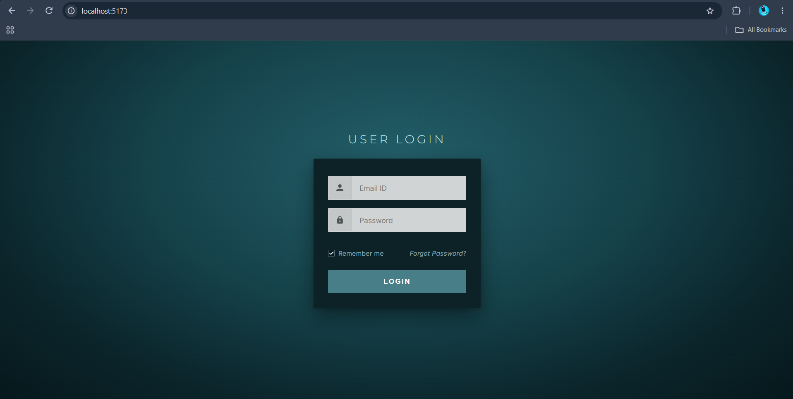
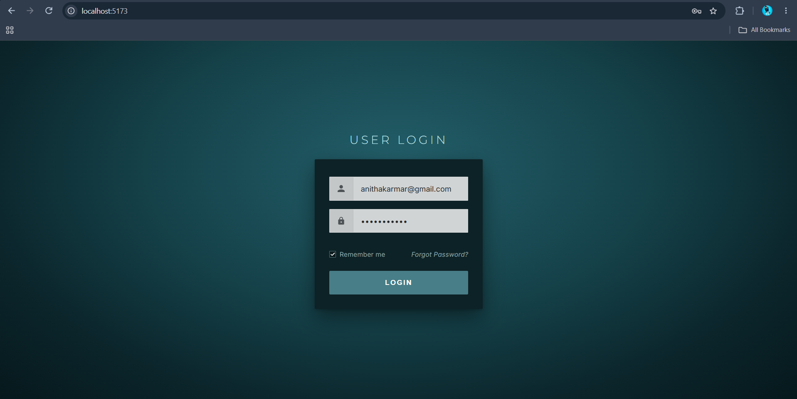
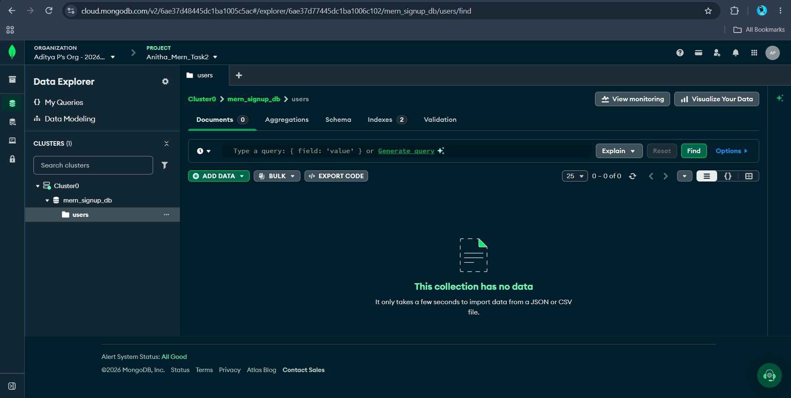
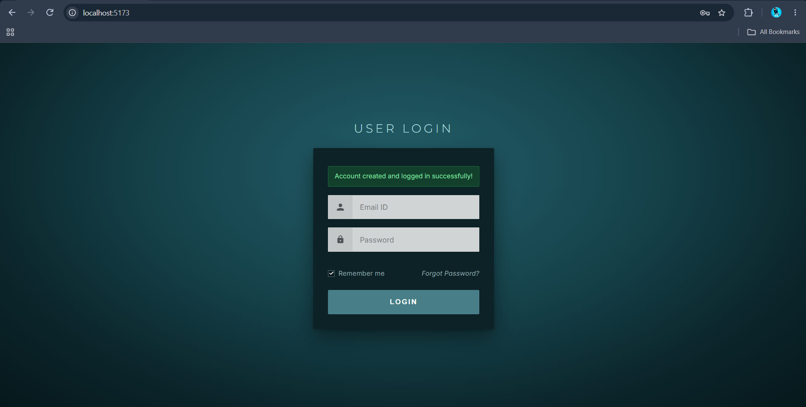
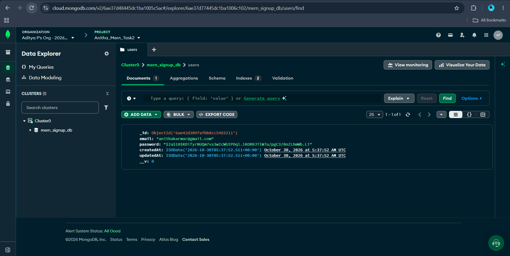

# MERN Stack - Login Feature (Task 2)

A full-stack user login and authentication system built using the **MERN** stack (MongoDB Atlas, Express.js, React, Node.js) with password hashing via `bcryptjs`.

---

## Output

### 1. Login Page
Initial clean login interface with Email ID and Password fields, Remember me checkbox, and Login button.


---

### 2. Inputting User Credentials for Login
User entering their email (`anithakarmar@gmail.com`) and password into the login form.


---

### 3. MongoDB Atlas Collection Before Login
MongoDB Atlas database (`mern_signup_db -> users`) showing that the collection is currently empty before the user logs in.


---

### 4. Output After Pressing Login Button
The React UI displaying the green success notification banner (**"Account created and logged in successfully!"**) after the REST API processes the login request.


---

### 5. MongoDB Atlas After Login (Data Stored)
MongoDB Atlas Data Explorer showing the newly created user document stored in the cloud with timestamps and encrypted password hash (`bcrypt`).


---

## How to Run Locally

### 1. Setup Backend
```bash
cd backend
npm install
# Configure your MongoDB URI in backend/.env
npm run dev
```
Server starts on `http://localhost:5000`.

### 2. Setup Frontend
```bash
cd frontend
npm install
npm run dev
```
Client starts on `http://localhost:5173`.
